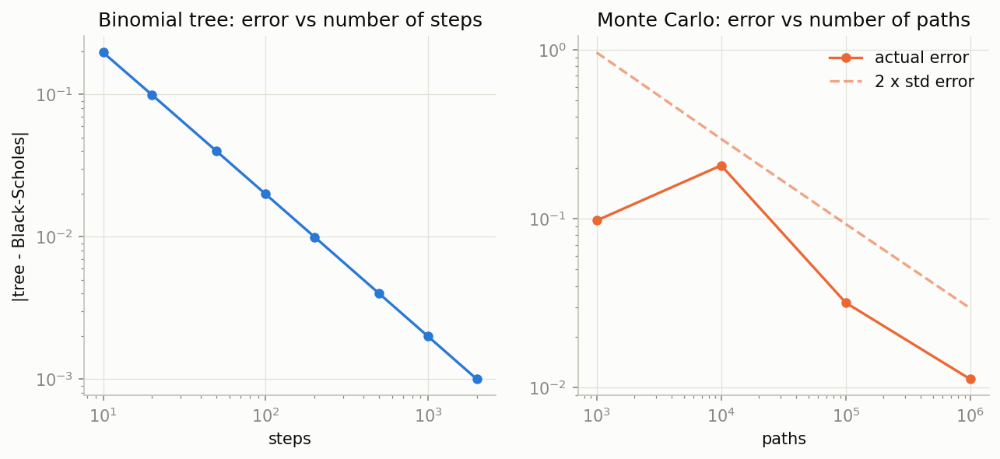
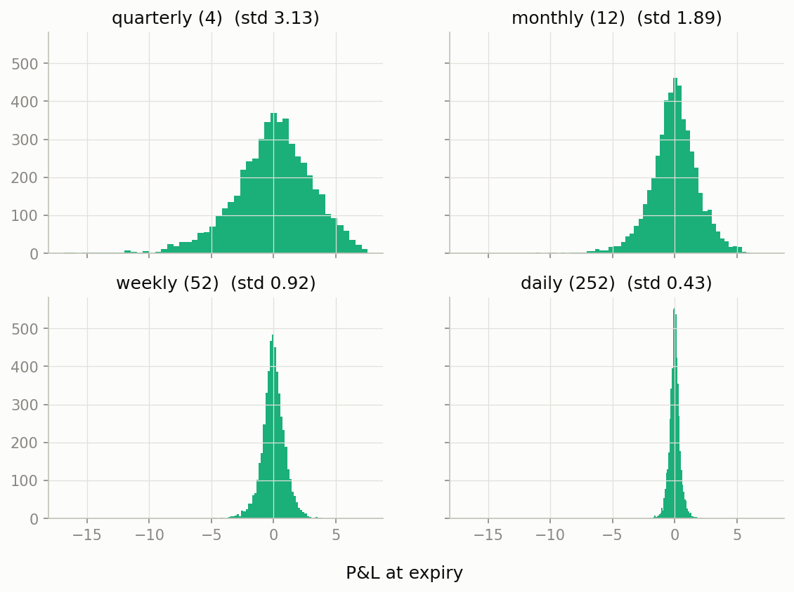

# 1. Black-Scholes pricer

Prices European options three different ways, computes the Greeks, backs out implied
volatility, and then shows where Black-Scholes stops matching the market.

## What's in it

| File | What it does |
|------|--------------|
| `black_scholes.py` | Closed-form price, delta, gamma, vega, theta, rho, and an implied-vol solver (Newton-Raphson with a bisection fallback) |
| `binomial_tree.py` | Cox-Ross-Rubinstein tree, European and American |
| `monte_carlo.py` | Plain Monte Carlo price with a standard error |
| `hedging.py` | Simulates selling a call and delta-hedging it at a chosen frequency |
| `smile.py` | Implied vol smile from a live option chain (falls back to a synthetic one offline) |
| `app.py` | Streamlit dashboard: move the sliders, watch price and Greeks change |
| `demo.py` | Runs everything and saves figures |

## Run it

```bash
python -m bs_pricer.demo
streamlit run bs_pricer/app.py
```

## What the demo shows

**The tree and Monte Carlo converge to the closed form.** The tree's error shrinks as
steps increase; Monte Carlo's error shrinks like 1/sqrt(paths), and stays inside its own
error bars.



**Hedging more often gives a tighter P&L.** Selling a call and delta-hedging it
should replicate it perfectly if we could trade continuously. With discrete rebalancing,
the P&L has a spread that falls roughly like 1/sqrt(number of hedges).



**The volatility smile.** Black-Scholes assumes one volatility per option, but market
prices imply a different one at each strike. `smile.py` prices real SPY options when it
can connect to Yahoo Finance and labels the plot "synthetic" when it can't.

## The maths

For a call with spot `S`, strike `K`, expiry `T`, rate `r` and volatility `sigma`:

```
d1 = [ ln(S/K) + (r + sigma^2 / 2) T ] / (sigma sqrt(T))
d2 = d1 - sigma sqrt(T)
Call = S N(d1) - K exp(-rT) N(d2)
```

Implied volatility is the `sigma` that makes this equal an observed price. Newton-Raphson
uses vega as the slope. It is fast but can overshoot for deep out-of-the-money options,
so the code falls back to bisection when it does.

## Assumptions to be aware of

Constant volatility and rate, no jumps, lognormal prices, continuous trading with no
costs. The smile and the hedging error are the visible consequences of these being false.

## Ideas to extend it

- Add the Heston model and calibrate it to the smile.
- Hedge with transaction costs (see project 5 for a neural-network version).
- Add dividends via a discrete schedule instead of a continuous yield.
